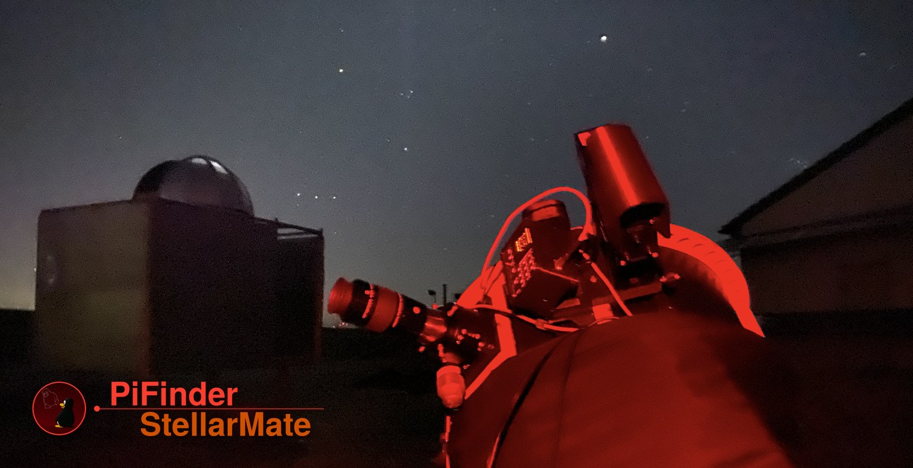
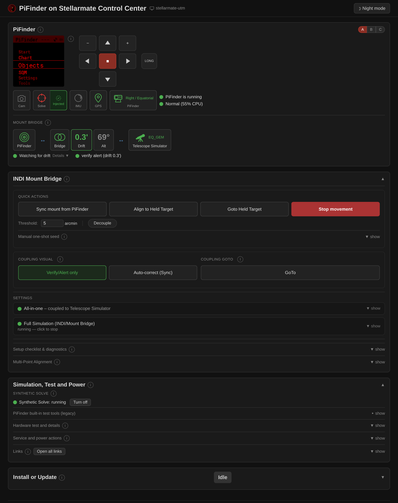
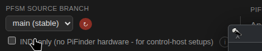
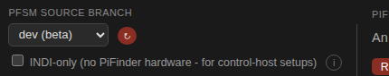
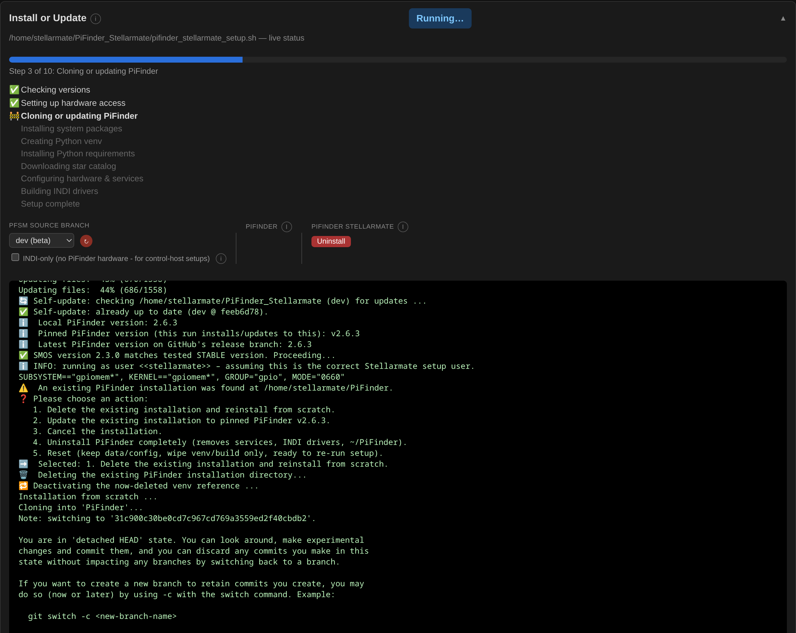
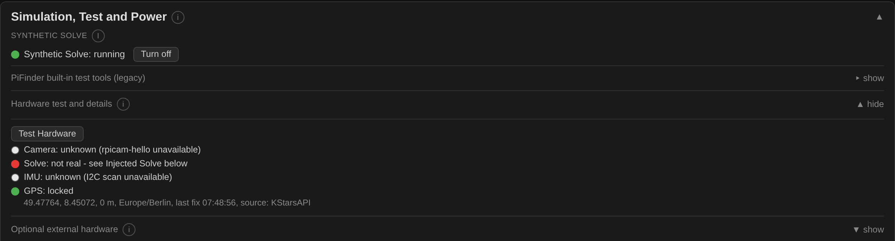
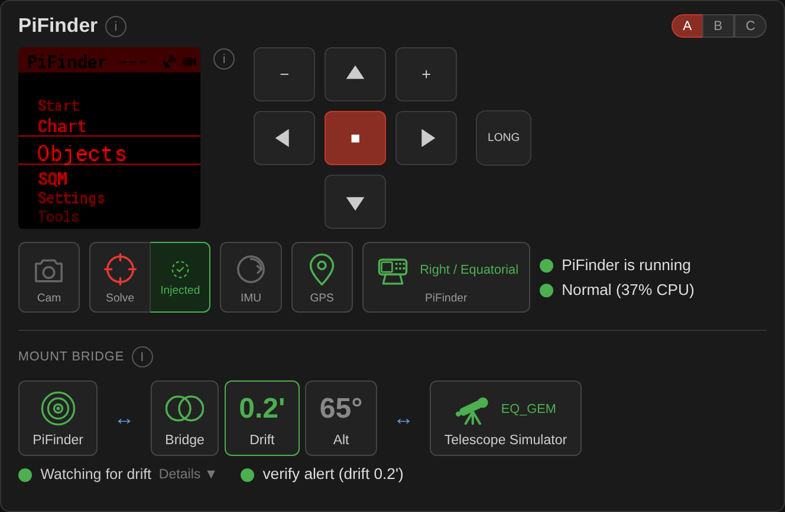
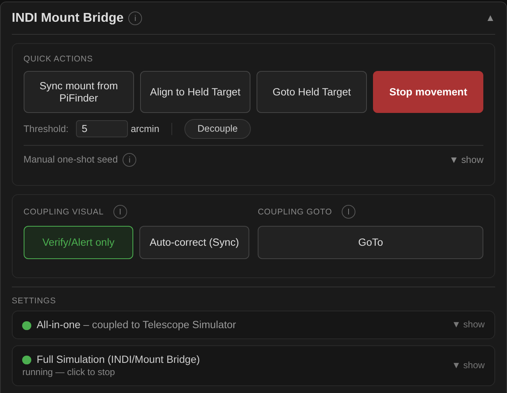
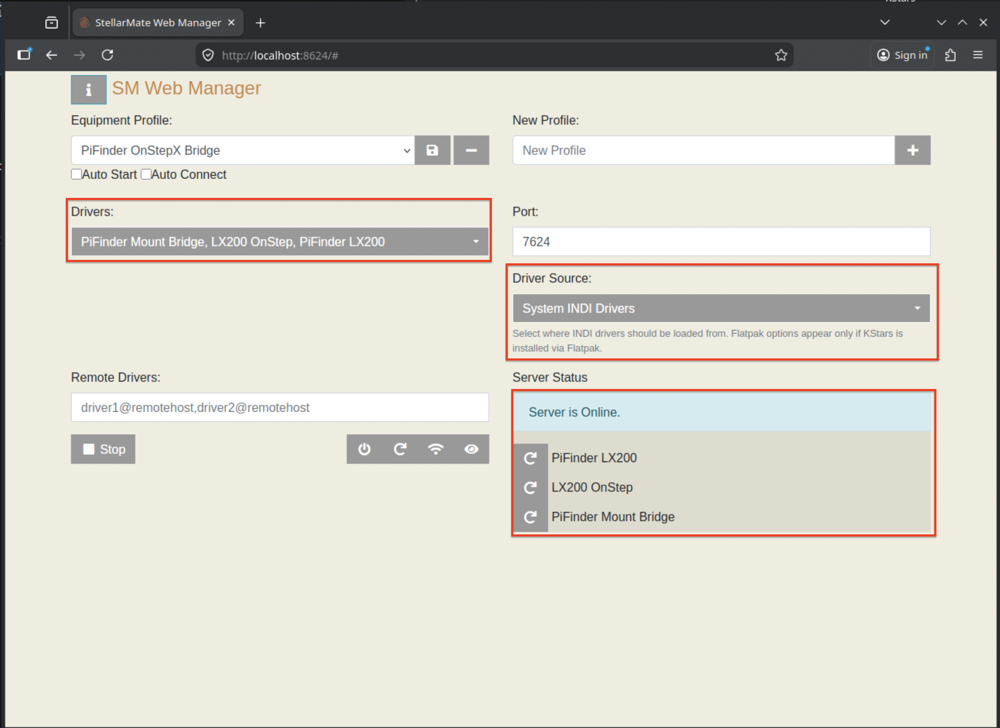
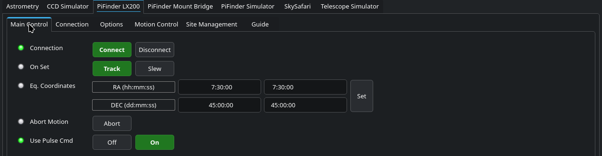

# PiFinder on Stellarmate

*[Deutsche Version](README_de.md)*



> ### 🚀 **Release note — v3.2.0**
>
> Fewer wrong moves from wrong data. **Still not stable** and not tested under the real sky - please read
> [Status of 3.2.0](#status-of-320-not-stable-yet) first.
>
> * **Uncertain plate solves are not used**: the Mount Bridge neither moves nor syncs on them (adjustable, "Solve certainty").
> * **Multi-Point Alignment** also counts a point that a mount with its own model took in.
> * Housekeeping: an unused file that raised all security alerts is gone; Discord links updated.
>
> New in 3.1.0: park is park, OnStep over USB, mounts with their own alignment, time and location check. New in 3.0.0: GoTo
> from anywhere ends on the object, OnStep Multi-Point Alignment, the simulated sky. Control Center port **8777** (see
> [Ports](#ports)). All changes: [CHANGELOG.md](CHANGELOG.md). Contributing and bug reports: [CONTRIBUTING.md](CONTRIBUTING.md).

## Summary

This project installs, patches, and integrates the [PiFinder](https://www.pifinder.io/)
plate-solving push-to system into a [StellarMate](https://www.stellarmate.com/) setup, so a single
Raspberry Pi runs PiFinder's plate-solving and object-finding **alongside** StellarMate for
astrophotography, EAA, and full equipment control. The setup script automates the whole process.

**The building blocks, and why:**

- **Raspberry Pi** — the platform both PiFinder and StellarMate already target.
- **PiFinder** — a Python-based push-to solver with a **global-shutter camera** (clean plate-solves
  even while the mount is moving). Open source in both hardware and software, which is what makes
  integrating it feasible at all: the setup patches it in place instead of forking it.
- **StellarMate** — a well-maintained community project with an open-source core and a strong app
  ecosystem (StellarMate App, KStars/Ekos, INDI Web Manager) for driving a full imaging rig.
- **INDI** — the glue between the two. Both sides already speak it: PiFinder exposes its solved
  position as an INDI telescope, and the optional **Mount Bridge** couples that to any
  INDI-supported motorised mount — no mount-specific protocol, no custom code per mount.

**Fundamental principles:**

- Keep the original PiFinder software as untouched as possible.
- Decouple the different components so they can be used independently.
- Work with any INDI-compatible mount rather than tying the project to a particular manufacturer.
- Reuse the existing capabilities of KStars, Ekos, INDI, and SkySafari.
- Keep the integration lightweight and focused rather than duplicating functionality already
  provided by the INDI ecosystem.

(The INDI-integration-specific elaboration of these — build choices, driver architecture — lives in
[Readme_design_decisions.md](Readme_design_decisions.md).)

> ### ⚠️ **Disclaimer**
>
> * This is a community project and is not officially affiliated with PiFinder or Stellarmate.
> * Use these scripts at your own risk. The author is not responsible for any damage to your hardware or software.
> * This process has been tested with the PiFinder version specified in `version.txt`.

> ### ✅ **Current Pinned Versions**
>
> * Pinned to **PiFinder 2.6.4** on **StellarMate OS 2.4.0** (Arch Linux) via `version.txt` /
>   `pifinder_stellarmate_setup.sh` — a fixed release tag, not the upstream `release` branch's moving
>   HEAD. With PFSM 3.2.0 tested on a Pi 5 so far; Pi 4 and x86 are pending —
>   [Version Compatibility](#version-compatibility) has the details.
> * **Pi 5 keyboard ⚠️** — a Geekworm X1203 UPS shield shares GPIO 16 with keypad column 0 (keys
>   7/4/1/LEFT), disabling that column. Hardware conflict between the two add-on boards, only with
>   that shield attached; a [numpad bridge](Readme_KeyboardBridge.md) sidesteps it.
> * **INDI integration** — standalone LX200 driver + optional Mount Bridge coupling, verified
>   end-to-end against a real Skywatcher EQ5 / OnStepX mount. See
>   [Readme_PiFinder_LX200.md](Readme_PiFinder_LX200.md).
> * **Control Center** — installs/updates, hardware checklist, Real / Full-Simulation / Fake-Mode
>   switching, the Mount Bridge, and Reboot/Shutdown, in one local web page. See
>   [Readme_ControlCenter.md](Readme_ControlCenter.md); shipped changes in [CHANGELOG.md](CHANGELOG.md).

---

## Status of 3.2.0: not stable yet

3.2.0 is a release for people who want to help testing. It has **not been tested under the real sky**.

| Area | State |
|---|---|
| Tested so far | Raspberry Pi 5 with the simulated sky ("Real Hardware + GSC Simulation") and the INDI simulators; a real OnStep controller driven indoors with a simulated PiFinder sky; automated regression run (`test_tools/run_regression.sh`) |
| Raspberry Pi 4, x86 (UTM) | installation and update with 3.x not tested yet. On x86 the simulated sky needs PiFinder's built-in star finder; the patch for that is new and untested on x86 |
| Standard PiFinder (own SD card) as **PiFinder Client** | not tested |
| **Control Host / Client** combination | works in basic form, not tested thoroughly |
| Real mount | GoTo following, refining and the OnStep alignment seen only with a simulated sky; a physical hand controller was not tried separately (it sends the same network commands) |
| OnStep over **USB/serial** | a GoTo from the controller is followed to where the slew ends (seen with a stand-in driver; the signals it relies on were measured on a real OnStep). Multi-Point Alignment sends plain Syncs |
| Camera and sky | no camera or sky test with the pinned PiFinder 2.6.4 |
| Simulated sky | single star fields cannot be solved or are solved wrongly ([#697](https://github.com/apos/PiFinder_Stellarmate/issues/697)); the Mount Bridge does not use an uncertain solve and moves nothing |
| Uncertain plate solves | the limit of the Mount Bridge (false-positive probability 1e-8) comes from simulated data. Under a real sky with few stars it may refuse a correct solve: lower "Solve certainty" in the INDI panel then (0 takes every solve) |
| **SMOS updates** | an update can remove everything outside `/home`: run the post-update step (Control Center card or `bin/restore_after_smos_update.sh`). On devices that boot from NVMe/USB with renamed partitions (to keep an SD emergency system) an update can leave the device unbootable if the boot fix does not run before the reboot ([#561](https://github.com/apos/PiFinder_Stellarmate/issues/561), the automatic fix has not been seen on real hardware); details in [SMOS Updates](#smos-updates) |
| Pi 5 keypad | disabled column with a Geekworm X1203 UPS shield (see above) |
| Newer PiFinder versions | PiFinder 3.x (beta) is not supported; PFSM installs the pinned version |
| Documentation | no HowTo or video guide yet |

Everything else that is open: [issues](https://github.com/apos/PiFinder_Stellarmate/issues) and the
[GitHub Project](https://github.com/users/apos/projects/15).

---

## Table of Contents

1. [Status of 3.2.0](#status-of-320-not-stable-yet)
2. [Quick Start](#quick-start)
3. [Key Features & Changes](#key-features--changes)
4. [Hardware Requirements](#hardware-requirements)
5. [Installation](#installation)
6. [After Installation: PiFinder's "PFSM" Page](#after-installation-pifinders-pfsm-page)
7. [Ports](#ports)
8. [Using the INDI Driver](#using-the-indi-driver)
9. [SMOS Updates](#smos-updates)
10. [Version Compatibility](#version-compatibility)
11. [Roadmap](#roadmap)
12. [Uninstallation](#uninstallation)
13. [See Also](#see-also)

---

## Quick Start

**1. Browser install (recommended)**

```bash
git clone https://github.com/apos/PiFinder_Stellarmate.git
cd PiFinder_Stellarmate
bash gui_installer/launch_setup_gui.sh
```

The script prints every address the GUI is reachable under (one line per network interface) and
opens it in a browser automatically:

```
Starting setup GUI webserver...
Webserver started.
   Setup GUI reachable at:
     http://192.168.1.23:8777/
   Login: any username, password = your stellarmate system password
   (protects the page itself plus Reinstall/Update/Reboot; /state,
   /log and /shutdown stay reachable without login)
   To stop: gui_installer/launch_setup_gui.sh --shutdown-webserver
```

On a fresh StellarMate OS install that's username `stellarmate`, password `smate` — the StellarMate
OS default, not a project secret (change it if you haven't already).

From any other device on the same network, open one of those URLs directly (no desktop session on
the Pi required). See [Setup GUI / Control Center](#setup-gui--control-center-recommended) for details.

<table>
<tr>
<td align="center">
<a href="docs/images/readme/cc_full_page.png"></a><br>
<sub>The Control Center, opened from any browser on the network — no desktop session on the Pi needed (Full Simulation shown)</sub>
</td>
</tr>
</table>

**Stable vs. Beta**: the clone above checks out `main` (**Stable**, the latest tagged release) by
default. The Control Center's own **Install or Update** tile has a **PFSM Source Branch** dropdown
to switch to `dev` (**Beta**, the moving development branch) - or back to `main` - for any
install/reinstall/update it runs from then on, no manual `git checkout` needed:

<table>
<tr>
<td align="center" width="50%">
<a href="docs/images/readme/cc_branch_stable.png"></a><br>
<sub><b>main (stable)</b> selected</sub>
</td>
<td align="center" width="50%">
<a href="docs/images/readme/cc_branch_beta.png"></a><br>
<sub><b>dev (beta)</b> selected</sub>
</td>
</tr>
</table>

**2. Terminal install**

```bash
git clone https://github.com/apos/PiFinder_Stellarmate.git
cd PiFinder_Stellarmate
./pifinder_stellarmate_setup.sh
```

No dropdown here - switch branches with git itself before running the script, e.g.
`git clone -b dev https://github.com/apos/PiFinder_Stellarmate.git` for **Beta**, or
`git checkout main` / `git checkout dev` in an existing checkout.

Full details: [Installation](#installation).

> **Next step, either way: pick your equipment profile — the Control Center adds the PiFinder drivers.**
> A finished install alone does not make PiFinder usable via INDI/KStars/SkySafari: it needs an
> equipment profile of your own (create one in the StellarMate App or in the Web Manager,
> `http://<pi-address>:8624`; the read-only "Simulators" default does not count). In the Control
> Center's **INDI Mount Bridge** tile, select that profile and click a **Role** card or **One-Click
> Setup** — the PiFinder drivers are then added for you, nothing to tick by hand.
> See [Readme_ControlCenter.md — Next: set up your equipment profile](Readme_ControlCenter.md#next-set-up-your-equipment-profile).

---

## Key Features & Changes

This setup modifies the stock PiFinder installation to better integrate with Stellarmate:

*   **Automated Installation:** A single script handles downloading the correct PiFinder version, creating a Python virtual environment, installing dependencies, and applying all necessary patches.
*   **INDI Integration for KStars/Ekos & SkySafari:** A standalone `PiFinder LX200` INDI driver reports PiFinder's solved position and forwards GoTo requests as push-to targets. An optional `PiFinder Mount Bridge` driver can couple that position to any real INDI mount driver (verify/alert, auto-correct on drift, or full event-driven GoTo-forwarding). Built directly against system `libindi` — no INDI source checkout, no full INDI build. Built and installed automatically by the main setup script — see [Readme_PiFinder_LX200.md](Readme_PiFinder_LX200.md) for the technical reference and illustrated setup instructions (Web Manager profile, INDI Control Panel, KStars/Ekos, SkySafari).
*   **Stellarmate GPS Integration:** PiFinder is configured to use Stellarmate/KStars as its GPS source, removing the need for a separate GPS module on the PiFinder.
*   **Network Management Disabled:** All network configuration options (WiFi Mode, AP/Client switching) have been removed from the PiFinder's OLED menu and Web Interface. This prevents conflicts, as Stellarmate is responsible for all network management.
*   **Robust Patching:** Changes are applied using `diff` patches, making the process more reliable and easier to maintain than manual file edits.
*   **Compatibility:** The scripts are designed for Raspberry Pi 4 and Pi 5 running Stellarmate OS (Arch Linux). Both are fully supported — see the version banner above for the current per-Pi status.
*   **Comprehensive IP Address Display:** The web interface and the device's OLED status screen now show all available non-localhost IP addresses, providing better network visibility.
*   **Dynamic User:** The web interface authentication is patched to use the current system user (e.g., `stellarmate`) instead of a hardcoded default.
*   **Password-Protected Setup GUI:** `gui_installer/`'s webserver (destructive reinstall/update/reboot actions) now requires the same system-user password as PiFinder's own Remote login, checked via PAM — no separate password to remember.

## Hardware Requirements

### Raspberry Pi 4 *(works for basic tasks)*

| Component | Requirement |
|---|---|
| RAM | ≥ 4 GB (absolute minimum — 2 GB not possible) |
| Storage | USB 3.0 NVMe HAT (**mandatory** — SD card is not sufficient) |
| Power | Power HAT ≥ 5 A (**mandatory** — USB power is not enough) |

### Raspberry Pi 5 *(recommended)*

| Component | Requirement |
|---|---|
| RAM | > 4 GB (≥ 8 GB recommended) |
| Storage | NVMe HAT with PCIe (**mandatory** — SD card is not sufficient) |
| Power | Power HAT ≥ 5 A (**mandatory** — USB-C PD 5 A may work) |

> **Note on Camera (Pi 5):** The Pi 5 uses a **15-pin FFC CSI connector**, while Pi 4 uses 22-pin. A cable adapter is required to connect the PiFinder camera module to a Pi 5.

---

## Installation

The setup process is designed to be straightforward. It will guide you through a fresh installation or updating an existing one.

### Prerequisites

*   A Raspberry Pi 4 or Pi 5 with PiFinder hardware (hat, screen, camera, etc.).
*   **A current StellarMate OS (SMOS) installation — the only supported base.** Pinned to and tested
    against StellarMate OS 2.4.0 (Arch Linux); the setup script warns (but proceeds) if your SMOS
    version differs from this tested pin. **Installing onto a stock PiFinder OS image is not
    supported** — this project's entire premise is the StellarMate integration (INDI, KStars/Ekos,
    the Web Manager, the app), none of which a stock PiFinder OS provides, so there would be nothing
    for it to integrate with.
*   Basic familiarity with the Linux command line.

### Setup Steps

1.  **Enable Hardware Interfaces:**
    SPI and I2C are enabled automatically by the setup script via `/boot/config.txt`. No manual step required on Stellarmate OS (Arch Linux). `raspi-config` is not available on this platform.

2.  **Clone the Repository:**
    Open a terminal on your Stellarmate device and clone this repository:
    ```bash
    git clone https://github.com/apos/PiFinder_Stellarmate.git
    cd PiFinder_Stellarmate
    ```

3.  **Run the Setup Script:**
    Execute the main setup script. It will detect if a PiFinder installation exists and give you options.
    ```bash
    ./pifinder_stellarmate_setup.sh
    ```

    *   **If no PiFinder is found:** The script will clone the official PiFinder repository and apply all the necessary patches.
    *   **If PiFinder is found:** You will be prompted to either:
        *   **1. Reinstall from scratch:** This will completely delete the existing PiFinder directory and perform a fresh installation.
        *   **2. Update:** This will reset your local PiFinder to this project's pinned release tag (see `version.txt`) and re-apply all patches.

4.  **Python Virtual Environment (First Run Only):**
    The first time you run the script on a fresh system, it will stop after creating a Python virtual environment (`.venv`). You must activate it manually and re-run the script to complete the installation of dependencies. The script will provide the exact commands to run, which will look like this:
    ```bash
    source /home/stellarmate/PiFinder/python/.venv/bin/activate
    ./pifinder_stellarmate_setup.sh
    ```
    After this, the installation will complete, the PiFinder services will be started, and the
    PiFinder LX200 + Mount Bridge INDI drivers will be built and installed automatically — see
    [Using the INDI Driver](#using-the-indi-driver) below for what that gives you and how to set
    up the Web Manager profile.

### Setup GUI / Control Center (recommended)

Rather than watching raw terminal output, `gui_installer/` provides a small local web page — the
**PiFinder on Stellarmate Control Center** — that runs the same setup script with a live status view
in the browser (Reinstall / Update / Reset / Uninstall as buttons, each confirming first), and then
doubles as an ongoing dashboard: the hardware checklist, Real / Full-Simulation / Fake-Mode
switching, the INDI **Mount Bridge** (Coupling presets, one-shot sync actions, guided setup), and
Reboot / Shutdown.

Full documentation — architecture, every tile, the Mount Bridge sync workflows, the API surface — is
in **[Readme_ControlCenter.md](Readme_ControlCenter.md)** ([Deutsche Version](Readme_ControlCenter_de.md)).

```bash
bash gui_installer/launch_setup_gui.sh          # start (idempotent; prints its URLs)
bash gui_installer/launch_setup_gui.sh --shutdown-webserver   # stop
```

Starting it prints one URL per network interface — open whichever one is reachable from your
device:

```
Starting setup GUI webserver...
Webserver started.
   Setup GUI reachable at:
     http://192.168.1.23:8777/
   Login: any username, password = your stellarmate system password
   (protects the page itself plus Reinstall/Update/Reboot; /state,
   /log and /shutdown stay reachable without login)
   To stop: gui_installer/launch_setup_gui.sh --shutdown-webserver
```

On a fresh StellarMate OS install that's username `stellarmate`, password `smate` — the StellarMate
OS default, not a project secret (change it if you haven't already).

Or copy/symlink `PiFinder Setup.desktop` into `~/Desktop/` for a clickable icon.

> **Developing without a Pi?** [Readme_UTM_dev_X86.md](Readme_UTM_dev_X86.md) turns an x86 StellarMate
> OS image (UTM VM on a Mac) into a full control-host + simulator dev machine — the Control Center,
> the setup scripts, and the Mount Bridge coupling logic run against the **PiFinder Simulator** and
> **Injected Solve** ([Readme_PiFinder_Simulator.md](Readme_PiFinder_Simulator.md)), no hardware
> needed.

<table>
<tr>
<td align="center" width="50%">
<a href="docs/images/readme/cc_install_running.png"></a><br>
<sub>Install or Update: a 10-step progress bar, a per-phase checklist, and the setup script's live terminal output in one tile</sub>
</td>
<td align="center" width="50%">
<a href="docs/images/readme/cc_mode_tile.png"></a><br>
<sub>Simulation, Test and Power: Synthetic Solve, the direct-against-hardware checklist, and collapsible service/power actions</sub>
</td>
</tr>
<tr>
<td align="center" width="50%">
<a href="docs/images/readme/cc_mount_bridge_baseline.png"></a><br>
<sub>The PiFinder tile: OLED mirror and quick keys, the Cam/Solve/IMU/GPS badges, and the Mount Bridge connection diagram (drift, altitude, coupling)</sub>
</td>
<td align="center" width="50%">
<a href="docs/images/readme/cc_mount_bridge_coupling.png"></a><br>
<sub>The INDI Mount Bridge tile: Quick Actions, the Coupling presets, and the guided setup checklist (collapsed)</sub>
</td>
</tr>
</table>

## After Installation: PiFinder's "PFSM" Page

Once PiFinder is up, its own website (`/remote`, password `smate` by default) gets a new
**"PFSM"** nav entry (`/smos`). It's the on-device companion to the two manual steps below,
ordered by how often you actually need them:

1. **PFSM Control Center status/control** — shows whether `gui_installer/`'s webserver is
   currently running, with a Start button when it isn't, so you can relaunch it (e.g. to update
   PiFinder later) without opening a terminal. Reachable-at links for the Control Center itself
   are listed too.
2. **Web Manager setup (one-time)** — collapsed by default (it's only needed once per install);
   expand it for the same screenshot as [Readme_PiFinder_LX200.md](Readme_PiFinder_LX200.md) plus
   direct links to the Web Manager for every IP this Pi has, so you don't have to hunt down the
   port (`8624`) yourself.

This page requires no login (same reasoning as PiFinder's own home page — it needs to work right
after a fresh boot) and is meant to be the first thing you check after a fresh install, an update,
or a reboot.

<p align="center">
<a href="docs/images/pfinder_lx200/webmanager_profile.png"></a><br>
<sub>Web Manager setup step (expanded): StellarMate Web Manager profile with the PiFinder LX200 and PiFinder Mount Bridge drivers running</sub>
</p>

## Ports

| Port | Who | What |
|---|---|---|
| 80 | StellarMate (nginx) | forwards everything to EkosLive on port 3000 |
| 8080 | PiFinder | web page and API; it takes 8080 because 80 is occupied |
| 8624 | StellarMate | INDI Web Manager: start and stop a profile |
| 7624 | StellarMate | indiserver with all drivers |
| 4030 | PiFinder | position and GoTo, also for this project's LX200 driver |
| 8777 | PFSM | Control Center |

- A PiFinder on **its own** operating system serves its web page on port 80. The PFSM drivers therefore ask 8080 first and use
  80 only when nothing listens on 8080.
- Port **8765** belongs to KStars/Ekos (MCP server). The Control Center used it up to v2.0.1.
- Profiles that mix driver sources run a second indiserver (seen on port 20001) for the PFSM drivers.
- An **OnStep** controller connected over the network serves one client per command port: the INDI driver uses its configured
  port (usually 9999), the Mount Bridge reads on another one (9998, 9997 or 9996).

---

## Using the INDI Driver

`pifinder_stellarmate_setup.sh` builds and installs both INDI drivers for you (stopping any
already-running instance first, then restarting the StellarMate Web Manager so the new/updated
drivers show up in its catalog). You only need to run the build scripts yourself when you want to
rebuild just the drivers without rerunning the whole setup (e.g. after pulling a driver-only code
change):

```bash
cd ~/PiFinder_Stellarmate
bash bin/build_indi_driver.sh     # PiFinder LX200
bash bin/build_indi_bridge.sh     # PiFinder Mount Bridge (optional, only if you have a real mount)
```

<a href="docs/images/pfinder_lx200/indi_control_panel_tabs_PiFinder_LX200_main.png"></a><br>
<sub>PiFinder LX200's own INDI Control Panel tab, connected and reporting a live solved position</sub>

For the full setup walkthrough (StellarMate Web Manager profile, INDI Control Panel, KStars/Ekos
Remote mode, SkySafari), the complete LX200 command/property reference, and an explanation of the
code and deployment strategy, see **[Readme_PiFinder_LX200.md](Readme_PiFinder_LX200.md)**.

### Starting a GoTo: PiFinder, KStars or the StellarMate app (SLEW and GO)

With the Mount Bridge in the "GoTo" coupling the aim is the same wherever you start: **the scope ends up on the object**. After the
slew the Bridge waits for a PiFinder plate solve and, while PiFinder sees the scope more than the threshold (default 5 arcmin,
set in the Control Center) away from it, syncs the mount and sends the GoTo again (up to 3 times). PiFinder's title bar shows
`MOUNT MOVING`, then `ON TARGET`.

| You start it with | Brought onto the object by the Bridge? |
|---|---|
| PiFinder: select an object (push-to) | yes |
| KStars: right-click an object → **PiFinder LX200** → Goto | yes |
| KStars / Ekos: Goto on the mount, StellarMate app **SLEW**, any other INDI client | yes |
| StellarMate app: **GO** | yes. Ekos then also takes an image through the **telescope camera** and solves it; see "Alignment in Ekos" below |
| OnStep hand controller, OnStep app or SkySafari connected to the OnStep controller | yes, when the mount is connected **over the network**: the Bridge reads the controller's target on a second network port, read only ([#658](https://github.com/apos/PiFinder_Stellarmate/issues/658)). Over **USB/serial**: yes too; the driver does not pass on the controller's target, so the place where the slew ends is taken as the object |

**If the object is not reached** after 3 attempts, the Bridge stops, shows `OFF TARGET` and moves nothing until the next GoTo.
Check the mount's alignment model then.

**By hand** (direction buttons, hand controller arrows): the new position is taken over and the mount is synced to PiFinder;
the Bridge does not pull back. If the mount did not move itself (clutch open, scope bumped), the Control Center shows a yellow
card with the question; nothing moves until it is answered.

**Park and Home - park is park**: when the mount parks or goes home (Control Center, KStars, app or hand controller) the
Bridge does not sync it, does not take the position over and moves nothing until the next GoTo.

**A mount with its own alignment** (set up on its hand controller): tick "Mount has its own alignment" in the Control Center.
The Bridge then never syncs this mount by itself; GoTos you ask for are still checked and refined, and a difference is offered
as a Sync.

**Stop**: after an Abort in KStars/Ekos the Bridge does not move the mount again until the next GoTo. "Stop movement" in the
Control Center also switches the coupling off. Switching the coupling off stops a slew the Bridge started itself; a GoTo from elsewhere
runs on.

**Alignment in Ekos** (plate solve, polar alignment, mount model; also GO): the Bridge pauses while Ekos takes images, solves
or slews. Afterwards it moves nothing until the next GoTo.

| Ekos solver action | PiFinder | Mount Bridge |
|---|---|---|
| Sync / Slew to target, solved | aligned to the mount's position | moves nothing until the next GoTo |
| Nothing, solved | unchanged | moves nothing until the next GoTo |
| Solve failed, mount neither synced nor turned | unchanged | carries on a GoTo that was under way |

An alignment running on the OnStep controller (hand controller or app) pauses the Bridge
too: it neither moves nor syncs the mount (OnStep would count a Sync as an alignment star). Over USB/serial the Bridge sees it through the INDI OnStep driver ("Align Process").

**Multi-Point Alignment with an OnStep** (Control Center, mount connected over the network) is a real OnStep alignment: put the
mount into its home position, press Start, and PiFinder's plate solves deliver the stars; **Save to OnStep** keeps the model.

## SMOS Updates

Stellarmate OS uses BTRFS snapshot resets to apply updates. This wipes the root partition, which removes all manually installed packages and configuration (pacman repos, systemd services, swap, etc.). The `/home` partition survives intact.

After every SMOS update, run the restore script:

```bash
bash ~/PiFinder_Stellarmate/bin/restore_after_smos_update.sh
sudo reboot
```

This restores everything PiFinder needs: pacman repos, system packages, hardware groups, udev rules, `/boot/config.txt` overlays, swapfile, and systemd services.

On a **Pi 4/Pi 5 that boots from NVMe/USB** (root label `SM_ROOT_NVM`/`SM_ROOT_NVE`, SD card kept as emergency system), a SMOS update can rewrite the boot configuration to `LABEL=SM_ROOT`, which that disk does not carry, so it never boots again (seen 2.3.0 → 2.4.0, [#561](https://github.com/apos/PiFinder_Stellarmate/issues/561)). The setup installs `smos-pre-reboot-fix.service`, which corrects the staged system when you reboot after the update; `bin/smos-post-update.sh` is the manual equivalent and, booted from the SD card with the disk attached, the repair tool (`--updatesd` refreshes the SD).

On a **non-Pi (x86) SMOS** — e.g. a Control host or the UTM dev VM — the Pi-specific steps are skipped; the same command instead runs the setup's non-interactive update path (`--action=update`, `--mode=full` or `indi_only` depending on how the machine was installed), which reinstalls the INDI drivers, the Control Center service, hardware groups and the GSC catalog, and restores `gh`.

### Syncing basic-memory / Claude context to Nextcloud

> **This is a maintainer-specific workflow, not a general PiFinder_Stellarmate setup step.** It
> only applies if you personally use [basic-memory](https://github.com/basicmachines-co/basic-memory)
> for Claude session context and already have your own Nextcloud WebDAV remote configured — most
> users won't have either and can skip this section entirely; it has no effect on PiFinder itself.

For those who do, the post-update script can also sync that local Claude AI memory/context to
Nextcloud:

```bash
bash ~/PiFinder_Stellarmate/bin/smos-post-update.sh --sync-memory
```

> **Note:** `rclone` is installed automatically by `restore_after_smos_update.sh`. The Nextcloud remote must be pre-configured in `~/.config/rclone/rclone.conf` (remote name: `nextcloud`, WebDAV).

## Version Compatibility

The single source of truth for which PiFinder / StellarMate OS / Raspberry Pi combinations this
project has been tested against. Other docs in this repo link here rather than repeating it.

| PiFinder | SMOS | Pi 4 | Pi 5 | UTM x86 (dev / simulator) |
|---|---|---|---|---|
| 2.6.4 | 2.4.0 | — (3.x not tested yet) | ✅ PFSM 3.2.0 with the simulated sky and the INDI simulators, automated regression run, a real OnStep driven indoors; no camera or sky test; keypad column lost with the UPS shield (see above) | — (3.0.0 not tested yet) |
| 2.6.3 | 2.4.0 | ✅ tested — real 2.3.0 → 2.4.0 update, restore, reboot from NVMe (see the NVMe note in "SMOS Updates"); camera hardware test pending | ⚠️ not verified on 2.4.0 (unreachable since the update) | ✅ tested — real 2.3.0 → 2.4.0 update and restore, Control Center, Mount Bridge vs. the PiFinder Simulator |
| 2.6.3 | 2.3.0 | ✅ fully tested | ✅ fully tested | ✅ tested — install, Control Center, Mount Bridge vs. the PiFinder Simulator (no real plate-solving; see [Readme_UTM_dev_X86.md](Readme_UTM_dev_X86.md)) |
| 2.6.0 | 2.2.1 | ✅ fully tested | ✅ GPS/Web UI/OLED confirmed, ⚠️ keyboard partially unusable with a Geekworm X1203 UPS attached (GPIO 16 conflict, see banner above) — camera adapter cable pending | — |
| 2.6.0 | 2.1.1 | ✅ tested | ⚠️ not re-verified since the OLED fix (hardware-based, so expected to carry over — see 2.2.1 row) | — |
| 2.5.1 | 2.1.1 | ✅ tested | — | — |

## Roadmap

Tracked, prioritized work — issues, test cases, next steps — lives in the
**[GitHub Project](https://github.com/users/apos/projects/15)**
([roadmap view](https://github.com/users/apos/projects/15/views/4)). Shipped changes are in
**[CHANGELOG.md](CHANGELOG.md)**. The direction:

**3.0.x — make it stable**

- Test on a Raspberry Pi 4, on x86 (UTM), on a standard PiFinder SD card as client, and the Control Host / Client combination.
- Camera and sky tests; real-mount runs through a whole night.
- SMOS updates: verify the automatic boot fix and restore on real hardware ([#561](https://github.com/apos/PiFinder_Stellarmate/issues/561)).
- A basic HowTo and a video guide.

**Later — integrate**

- Deeper StellarMate integration, in coordination with the SMOS project —
  [issue #35](https://github.com/apos/PiFinder_Stellarmate/issues/35),
  [issue #36](https://github.com/apos/PiFinder_Stellarmate/issues/36).
- The essential actions directly in the PiFinder app UI —
  [`docs/concepts/mount_bridge_web_integration.md`](docs/concepts/mount_bridge_web_integration.md) §7
  ([issue #43](https://github.com/apos/PiFinder_Stellarmate/issues/43)).
- A native **Ekos module** for PiFinder — [`docs/concepts/ekos_pifinder_module.md`](docs/concepts/ekos_pifinder_module.md)
  ([issue #370](https://github.com/apos/PiFinder_Stellarmate/issues/370)).
- Contribute selected changes back to [PiFinder](https://github.com/brickbots/PiFinder):
  [`docs/upstream_pr_templates.md`](docs/upstream_pr_templates.md),
  [`docs/upstream_patch_inventory.md`](docs/upstream_patch_inventory.md).

## Uninstallation

A script is provided to safely remove the PiFinder installation and services.

```bash
~/PiFinder_Stellarmate/bin/uninstall_pifinder_stellarmate.sh
```

This stops and disables every systemd unit this project installs (`pifinder`, `pifinder_splash`,
`pifinder-setup`, `pifinder-fake-mode-autostart`, `pifinder-control-center`,
`pifinder-numpad-bridge`), removes the PiFinder LX200 / Mount Bridge INDI drivers (binaries and
their `drivers.xml` catalog entries), removes the `/dev/gpiomem*` udev rule, unmasks
WirePlumber/PipeWire (masked during install to stop it from grabbing the camera), removes the Pi 5
`lgpio` build artifacts, and deletes the `~/PiFinder` directory. It will not remove the
`~/PiFinder_data` directory or the `PiFinder_Stellarmate` repository itself (delete those manually
if you want them gone too — the script prints the exact command). It also leaves a few genuinely
shared pieces of system config in place on purpose (the `/boot/config.txt` SPI/I2C/overlay lines,
the `python-libcamera` pacman version pin, and the hardware group memberships added to your user) —
the script prints what those are and why, in case you want to remove them by hand too.

The Control Center's own **Uninstall** button (see
[Setup GUI / Control Center](#setup-gui--control-center-recommended) above) runs this same script
with a `--selfmove` flag instead, which additionally deletes this `~/PiFinder_Stellarmate` checkout
itself - the terminal invocation above deliberately does not, so it's safe to run from within the
repo it's uninstalling.

## See Also

*   **[FAQ](docs/FAQ.md)** — short answers, for example whether PFSM keeps running while the phone's screen is locked. ([Deutsche Version](docs/FAQ_de.md))
*   **[Readme_ControlCenter.md](Readme_ControlCenter.md)** — full Control Center documentation: architecture, design principles, feature walkthrough, Mount Bridge & Sync workflows, API reference. ([Deutsche Version](Readme_ControlCenter_de.md))
*   **[Readme_PiFinder_LX200.md](Readme_PiFinder_LX200.md)** — the INDI layer: illustrated step-by-step setup (Web Manager equipment profile, INDI Control Panel, KStars/Ekos, SkySafari), LX200 command/property reference, code and deployment strategy. ([Deutsche Version](Readme_PiFinder_LX200_de.md))
*   **[Readme_KeyboardBridge.md](Readme_KeyboardBridge.md)** — the numpad-as-keypad bridge: architecture, key mapping, self-healing design. ([Deutsche Version](Readme_KeyboardBridge_de.md))
*   **[Readme_UTM_dev_X86.md](Readme_UTM_dev_X86.md)** — set up an x86 StellarMate OS VM (UTM on a Mac) as a hardware-free control-host + simulator dev machine. ([Deutsche Version](Readme_UTM_dev_X86_de.md))
*   **[Readme_PiFinder_Simulator.md](Readme_PiFinder_Simulator.md)** — the PiFinder Simulator / Injected Solve, for testing the Mount Bridge without a real mount or clear sky.
*   **[Readme_PiFinder_in_KStars.md](Readme_PiFinder_in_KStars.md)** — how KStars draws the PiFinder devices on the sky map, and what each device's right-click Goto/Sync/Abort operations actually do. ([Deutsche Version](Readme_PiFinder_in_KStars_de.md))
*   **[Readme_design_decisions.md](Readme_design_decisions.md)** — condensed summary of the key design decisions. ([Deutsche Version](Readme_design_decisions_de.md))
*   **[CHANGELOG.md](CHANGELOG.md)** — release history · **[GitHub Project](https://github.com/users/apos/projects/15)** — tracked roadmap.
*   **[bin/README_compile_indi.md](bin/README_compile_indi.md)** — quick build reference for the PiFinder LX200 driver.
*   **[CONTRIBUTING.md](CONTRIBUTING.md)** — where to ask (Discord), how to report an issue (conventions), and how to develop and test.
---

<p align="center">
  <br>
  © github.com/apos 2026<br>
  <em>Unofficial community project, not affiliated with StellarMate or PiFinder.</em>
</p>

<p align="center">
  <a href="https://www.youtube.com/heyapos" target="_blank" rel="noopener"></a>
  &nbsp;&nbsp;
  <a href="https://avvp.de" target="_blank" rel="noopener"></a>
</p>
