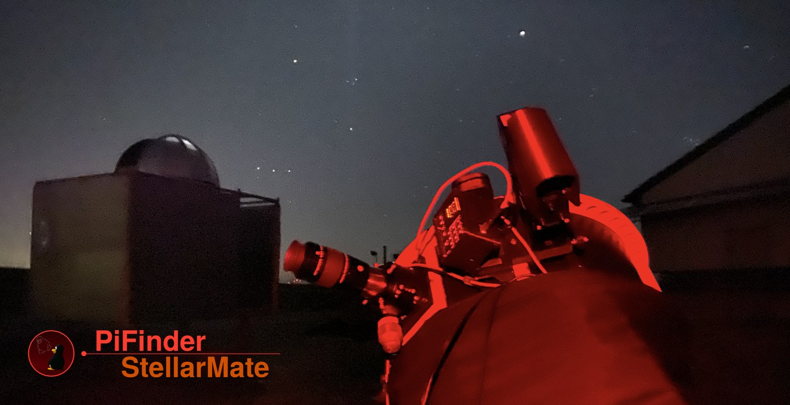
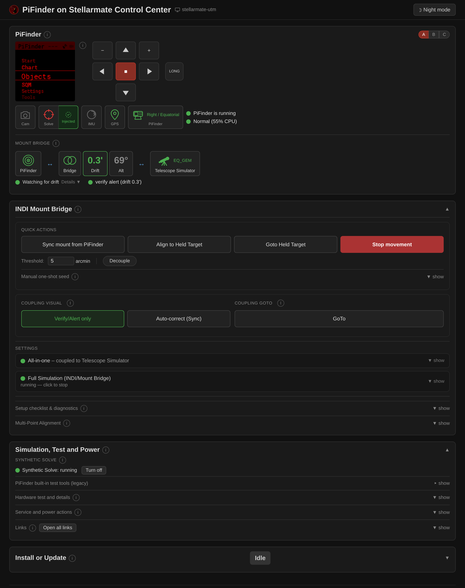
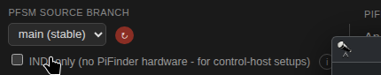
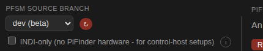
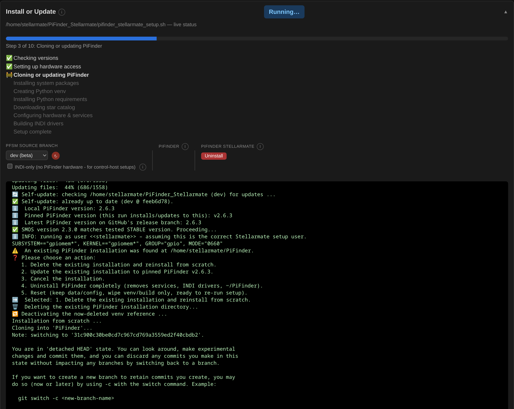
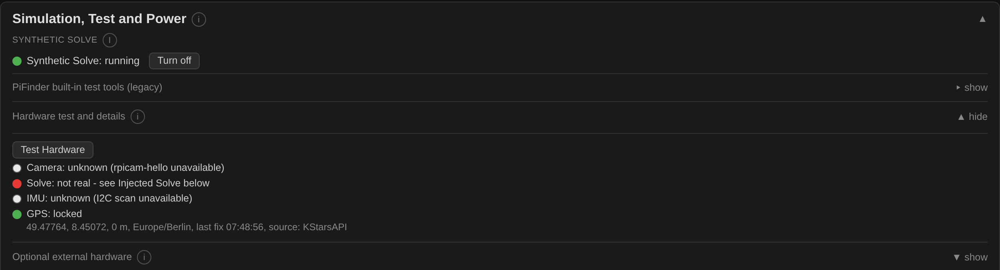
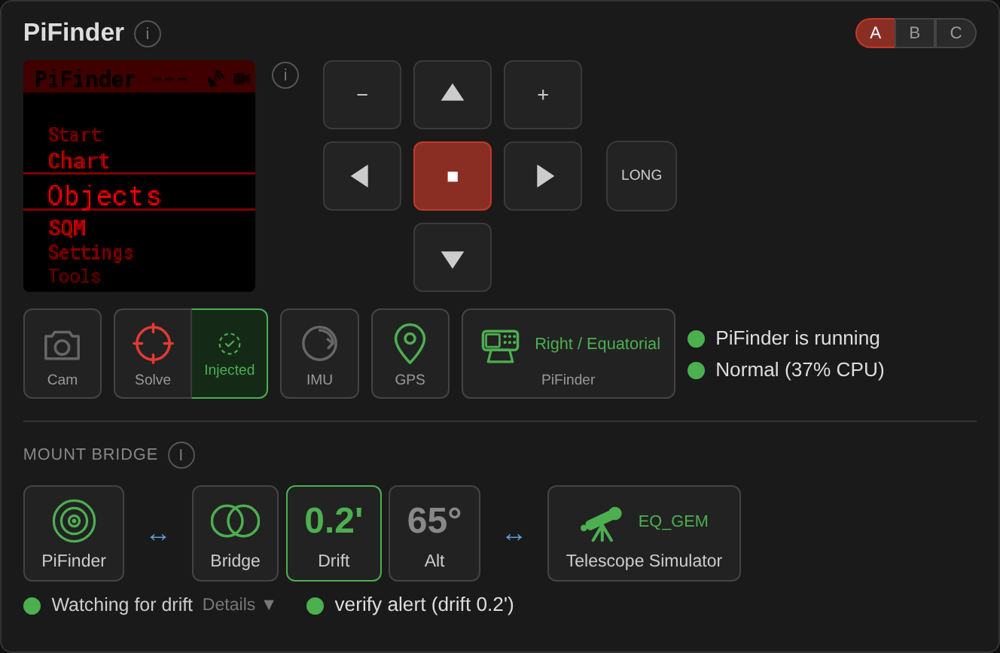
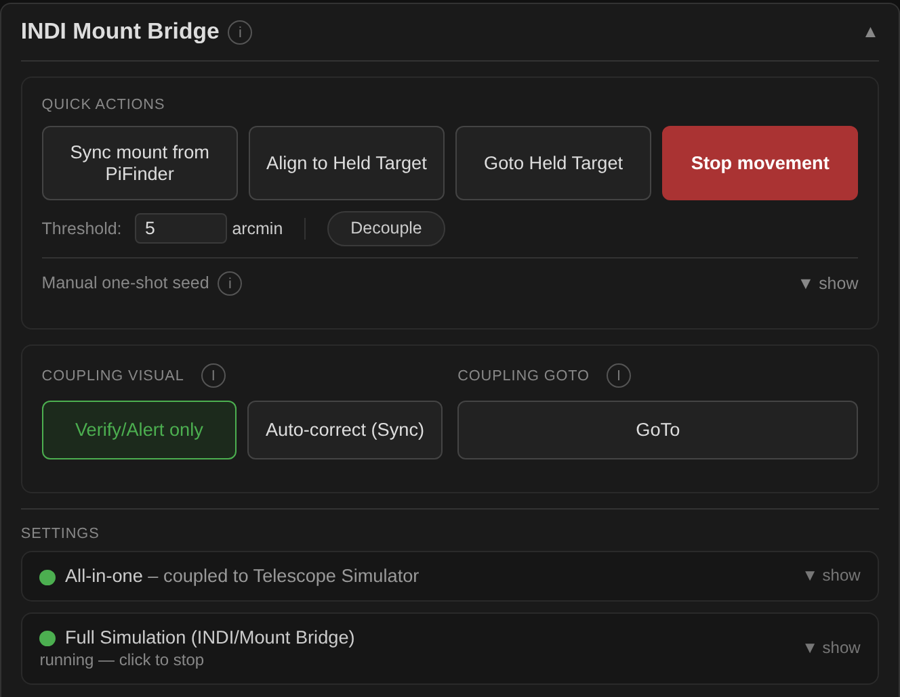
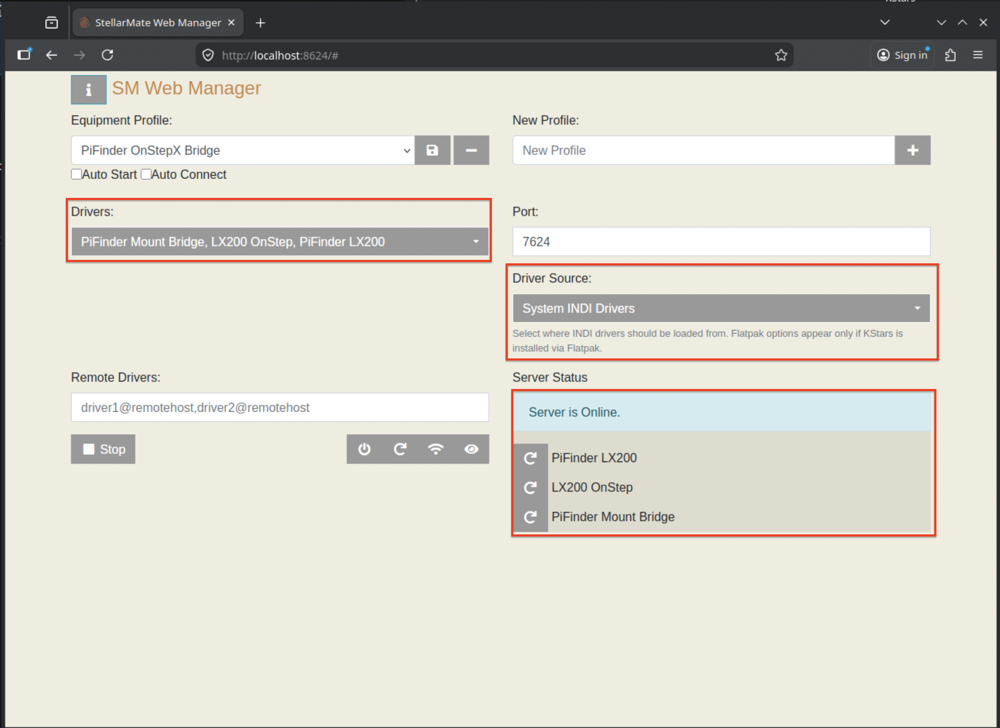
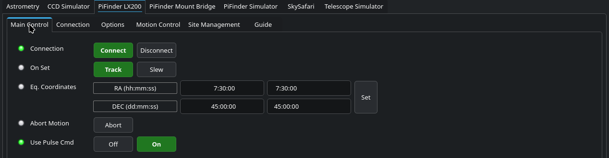

# PiFinder auf Stellarmate

*[English version](README.md)*



> ### 🚀 **Release-Hinweis — v3.2.0**
>
> Weniger falsche Bewegungen aus falschen Daten. **Noch nicht stabil** und nicht unter echtem Himmel getestet - bitte zuerst
> [Stand von 3.2.0](#stand-von-320-noch-nicht-stabil) lesen.
>
> * **Unsichere Plate-Solves werden nicht benutzt**: Die Mount Bridge bewegt und synct darauf nichts (einstellbar, "Solve
>   certainty").
> * **Multi-Point-Alignment** zählt auch einen Punkt, den eine Montierung mit eigenem Modell übernommen hat.
> * Aufgeräumt: Eine ungenutzte Datei, die alle Sicherheitsmeldungen auslöste, ist weg; Discord-Links aktualisiert.
>
> Neu in 3.1.0: Park ist Park, OnStep über USB, Montierungen mit eigenem Alignment, Zeit- und Standortprüfung. Neu in 3.0.0:
> GoTo von überall endet auf dem Objekt, OnStep-Multi-Point-Alignment, der simulierte Himmel. Control-Center-Port **8777**
> (siehe [Ports](#ports)). Alle Änderungen: [CHANGELOG.md](CHANGELOG.md). Mitmachen und Fehler melden:
> [CONTRIBUTING.md](CONTRIBUTING.md).

## Zusammenfassung

Dieses Projekt installiert, patcht und integriert das [PiFinder](https://www.pifinder.io/)-Plate-
Solving-Push-to-System in ein [StellarMate](https://www.stellarmate.com/)-Setup, sodass ein einzelner
Raspberry Pi PiFinders Plate-Solving und Objektsuche **neben** StellarMate für Astrofotografie, EAA
und vollständige Ausrüstungssteuerung betreibt. Das Setup-Skript automatisiert den gesamten Ablauf.

**Die Bausteine — und warum:**

- **Raspberry Pi** — die Plattform, die PiFinder und StellarMate ohnehin beide anvisieren.
- **PiFinder** — ein Python-basierter Push-to-Solver mit einer **Global-Shutter-Kamera** (saubere
  Plate-Solves auch während sich die Montierung bewegt). Open Source in Hard- *und* Software — genau
  das macht die Integration überhaupt machbar: Das Setup patcht ihn direkt an Ort und Stelle, statt
  ihn zu forken.
- **StellarMate** — ein gut gepflegtes Community-Projekt mit Open-Source-Kern und einem starken
  App-Ökosystem (StellarMate App, KStars/Ekos, INDI Web Manager) zum Steuern einer kompletten
  Imaging-Ausrüstung.
- **INDI** — der Kitt zwischen beiden. Beide Seiten sprechen es bereits: PiFinder stellt seine
  solvte Position als INDI-Teleskop bereit, und die optionale **Mount Bridge** koppelt das an jede
  INDI-unterstützte motorisierte Montierung — kein montierungsspezifisches Protokoll, kein
  Custom-Code pro Montierung.

**Grundprinzipien:**

- Die originale PiFinder-Software so unangetastet wie möglich lassen.
- Die einzelnen Komponenten entkoppeln, damit sie unabhängig voneinander nutzbar sind.
- Mit jeder INDI-kompatiblen Montierung funktionieren, statt das Projekt an einen bestimmten
  Hersteller zu binden.
- Die bestehenden Fähigkeiten von KStars, Ekos, INDI und SkySafari wiederverwenden.
- Die Integration schlank und fokussiert halten, statt Funktionalität zu duplizieren, die das
  INDI-Ökosystem bereits bietet.

(Die INDI-integrationsspezifische Ausarbeitung davon — Build-Entscheidungen, Treiber-Architektur —
lebt in [Readme_design_decisions_de.md](Readme_design_decisions_de.md).)

> ### ⚠️ **Haftungsausschluss**
>
> * Dies ist ein Community-Projekt und steht in keiner offiziellen Verbindung zu PiFinder oder Stellarmate.
> * Die Nutzung dieser Skripte erfolgt auf eigenes Risiko. Der Autor haftet nicht für Schäden an Hardware oder Software.
> * Dieser Ablauf wurde mit der in `version.txt` angegebenen PiFinder-Version getestet.

> ### ✅ **Aktuell gepinnte Versionen**
>
> * Gepinnt auf **PiFinder 2.6.4** auf **StellarMate OS 2.4.0** (Arch Linux) über `version.txt` /
>   `pifinder_stellarmate_setup.sh` — ein fester Release-Tag, nicht der bewegliche HEAD des upstream
>   `release`-Branches. Mit PFSM 3.2.0 bisher auf einem Pi 5 getestet; Pi 4 und x86 stehen aus —
>   [Versionskompatibilität](#versionskompatibilität) hat die Details.
> * **Pi 5 Tastatur ⚠️** — ein Geekworm-X1203-UPS-Shield belegt GPIO 16 gemeinsam mit Tastatur-
>   Spalte 0 (Tasten 7/4/1/LEFT), die Spalte fällt aus. Hardware-Konflikt zwischen den zwei
>   Aufsteck-Boards, nur mit diesem Shield; eine [Numpad-Bridge](Readme_KeyboardBridge_de.md) umgeht
>   das.
> * **INDI-Integration** — eigenständiger LX200-Treiber + optionale Mount-Bridge-Kopplung,
>   Ende-zu-Ende verifiziert gegen eine echte Skywatcher-EQ5 / OnStepX-Montierung. Siehe
>   [Readme_PiFinder_LX200_de.md](Readme_PiFinder_LX200_de.md).
> * **Control Center** — Installationen/Updates, Hardware-Checkliste, Umschaltung Real / Full
>   Simulation / Fake Mode, die Mount Bridge und Reboot/Shutdown, in einer lokalen Webseite. Siehe
>   [Readme_ControlCenter_de.md](Readme_ControlCenter_de.md); ausgelieferte Änderungen in
>   [CHANGELOG.md](CHANGELOG.md).

---

## Stand von 3.2.0: noch nicht stabil

3.2.0 ist ein Release für alle, die beim Testen helfen möchten. Es wurde **noch nicht unter echtem Himmel getestet**.

| Bereich | Stand |
|---|---|
| Bisher getestet | Raspberry Pi 5 mit simuliertem Himmel ("Real Hardware + GSC Simulation") und den INDI-Simulatoren; ein echter OnStep-Controller drinnen mit simuliertem PiFinder-Himmel; automatischer Regressionslauf (`test_tools/run_regression.sh`) |
| Raspberry Pi 4, x86 (UTM) | Installation und Update mit 3.x noch nicht getestet. Auf x86 braucht der simulierte Himmel PiFinders eingebaute Sternerkennung; der Patch dafür ist neu und auf x86 ungetestet |
| Standard-PiFinder (eigene SD-Karte) als **PiFinder Client** | nicht getestet |
| Kombination **Control Host / Client** | grundsätzlich lauffähig, nicht ausführlich getestet |
| Echtes Mount | GoTo-Verfolgung, Nachjustieren und OnStep-Alignment nur mit simuliertem Himmel gesehen; eine physische Handsteuerung nicht gesondert probiert (sie sendet dieselben Netzwerk-Befehle) |
| OnStep über **USB/seriell** | ein GoTo vom Controller wird bis zum Endpunkt der Fahrt verfolgt (mit einem Ersatztreiber gesehen; die zugrunde liegenden Signale sind an einem echten OnStep gemessen). Das Multi-Point Alignment sendet nur Syncs |
| Kamera und Himmel | kein Kamera- oder Himmelstest mit dem gepinnten PiFinder 2.6.4 |
| Simulierter Himmel | einzelne Sternfelder werden nicht oder falsch gelöst ([#697](https://github.com/apos/PiFinder_Stellarmate/issues/697)); eine unsichere Lösung benutzt die Mount Bridge nicht und bewegt nichts |
| Unsichere Plate-Solves | die Grenze der Mount Bridge (Irrtumswahrscheinlichkeit 1e-8) stammt aus Simulationsdaten. Unter echtem Himmel mit wenigen Sternen kann sie eine richtige Lösung ablehnen: dann "Solve certainty" im INDI-Panel senken (0 nimmt jede Lösung) |
| **SMOS-Updates** | ein Update kann alles außerhalb von `/home` entfernen: danach den Post-Update-Schritt ausführen (Karte im Control Center oder `bin/restore_after_smos_update.sh`). Auf Geräten, die von NVMe/USB mit umbenannten Partitionen booten (damit eine SD-Notfallkarte parallel möglich ist), kann ein Update das Gerät unbootbar machen, wenn der Boot-Fix nicht vor dem Neustart läuft ([#561](https://github.com/apos/PiFinder_Stellarmate/issues/561), der automatische Fix wurde auf echter Hardware noch nicht gesehen); Details unter [SMOS-Updates](#smos-updates) |
| Pi-5-Tastatur | eine Spalte fällt mit einem Geekworm-X1203-UPS aus (siehe oben) |
| Neuere PiFinder-Versionen | PiFinder 3.x (Beta) wird nicht unterstützt; PFSM installiert die gepinnte Version |
| Dokumentation | noch keine HowTo- oder Video-Anleitung |

Alles weitere Offene: [Issues](https://github.com/apos/PiFinder_Stellarmate/issues) und das
[GitHub-Projekt](https://github.com/users/apos/projects/15).

---

## Inhaltsverzeichnis

1. [Stand von 3.2.0](#stand-von-320-noch-nicht-stabil)
2. [Schnellstart](#schnellstart)
3. [Hauptfunktionen & Änderungen](#hauptfunktionen--änderungen)
4. [Hardware-Anforderungen](#hardware-anforderungen)
5. [Installation](#installation)
6. [Nach der Installation: PiFinders "PFSM"-Seite](#nach-der-installation-pifinders-pfsm-seite)
7. [Ports](#ports)
8. [Der INDI-Treiber](#der-indi-treiber)
9. [SMOS-Updates](#smos-updates)
10. [Versionskompatibilität](#versionskompatibilität)
11. [Roadmap](#roadmap)
12. [Deinstallation](#deinstallation)
13. [Siehe auch](#siehe-auch)

---

## Schnellstart

**1. Browser-Installation (empfohlen)**

```bash
git clone https://github.com/apos/PiFinder_Stellarmate.git
cd PiFinder_Stellarmate
bash gui_installer/launch_setup_gui.sh
```

Das Skript gibt jede Adresse aus, unter der die GUI erreichbar ist (eine Zeile pro
Netzwerkschnittstelle), und öffnet sie automatisch im Browser:

```
Starting setup GUI webserver...
Webserver started.
   Setup GUI reachable at:
     http://192.168.1.23:8777/
   Login: any username, password = your stellarmate system password
   (protects the page itself plus Reinstall/Update/Reboot; /state,
   /log and /shutdown stay reachable without login)
   To stop: gui_installer/launch_setup_gui.sh --shutdown-webserver
```

Auf einer frischen StellarMate-OS-Installation ist das Benutzername `stellarmate`, Passwort
`smate` — der StellarMate-OS-Standard, kein projektspezifisches Geheimnis (ändern, falls noch
nicht geschehen).

Öffne von jedem anderen Gerät im gleichen Netzwerk aus direkt eine dieser URLs (keine
Desktop-Sitzung auf dem Pi nötig). Details siehe
[Setup-GUI / Control Center](#setup-gui--control-center-empfohlen).

<table>
<tr>
<td align="center">
<a href="docs/images/readme/cc_full_page.png"></a><br>
<sub>Das Control Center, von einem beliebigen Browser im Netzwerk geöffnet — keine Desktop-Sitzung auf dem Pi nötig (Full Simulation gezeigt)</sub>
</td>
</tr>
</table>

**Stable vs. Beta**: der Clone oben checkt standardmäßig `main` aus (**Stable**, das zuletzt
getaggte Release). Die eigene **Install or Update**-Kachel des Control Centers hat dafür einen
**PFSM Source Branch**-Dropdown, um auf `dev` (**Beta**, der laufende Entwicklungs-Branch)
umzuschalten — oder zurück auf `main` — für jede Installation/Reinstallation/jedes Update ab dann,
ganz ohne manuelles `git checkout`:

<table>
<tr>
<td align="center" width="50%">
<a href="docs/images/readme/cc_branch_stable.png"></a><br>
<sub><b>main (stable)</b> ausgewählt</sub>
</td>
<td align="center" width="50%">
<a href="docs/images/readme/cc_branch_beta.png"></a><br>
<sub><b>dev (beta)</b> ausgewählt</sub>
</td>
</tr>
</table>

**2. Terminal-Installation**

```bash
git clone https://github.com/apos/PiFinder_Stellarmate.git
cd PiFinder_Stellarmate
./pifinder_stellarmate_setup.sh
```

Hier gibt es kein Dropdown — Branch vor dem Skript-Aufruf direkt per git wechseln, z. B.
`git clone -b dev https://github.com/apos/PiFinder_Stellarmate.git` für **Beta**, oder
`git checkout main` / `git checkout dev` in einem bestehenden Checkout.

Alle Details: [Installation](#installation).

> **Nächster Schritt in jedem Fall: Equipment-Profil wählen — die PiFinder-Treiber trägt das Control Center ein.**
> Eine fertige Installation allein macht PiFinder noch nicht über INDI/KStars/SkySafari nutzbar: Es
> braucht ein eigenes Equipment-Profil (einmal in der StellarMate App oder im Web Manager anlegen,
> `http://<pi-adresse>:8624`; der schreibgeschützte "Simulators"-Standard zählt nicht). In der
> Kachel **INDI Mount Bridge** des Control Centers dieses Profil wählen und eine **Rollen**-Karte oder
> **One-Click Setup** anklicken — die PiFinder-Treiber werden dann für dich eingetragen, von Hand
> ist nichts anzuhaken.
> Siehe [Readme_ControlCenter_de.md — Als Nächstes: Equipment-Profil einrichten](Readme_ControlCenter_de.md#als-nächstes-equipment-profil-einrichten).

---

## Hauptfunktionen & Änderungen

Dieses Setup passt die Standard-PiFinder-Installation an, um sie besser mit Stellarmate zu integrieren:

*   **Automatisierte Installation:** Ein einziges Skript kümmert sich um das Herunterladen der richtigen PiFinder-Version, das Anlegen einer Python-Virtual-Environment, die Installation der Abhängigkeiten und das Anwenden aller notwendigen Patches.
*   **INDI-Integration für KStars/Ekos & SkySafari:** Ein eigenständiger `PiFinder LX200`-INDI-Treiber meldet PiFinders gesolvte Position und leitet GoTo-Anfragen als Push-to-Ziel an PiFinder weiter. Ein optionaler `PiFinder Mount Bridge`-Treiber kann diese Position an jeden echten INDI-Mount-Treiber koppeln (Verify/Alert, Auto-Correct bei Drift, oder vollständiges event-basiertes GoTo-Weiterreichen). Linkt direkt gegen System-`libindi` — kein INDI-Source-Checkout, kein kompletter INDI-Build nötig. Wird automatisch vom Haupt-Setup-Skript gebaut und installiert — siehe [Readme_PiFinder_LX200_de.md](Readme_PiFinder_LX200_de.md) für die technische Referenz und bebilderte Einrichtungsschritte (Web-Manager-Profil, INDI Control Panel, KStars/Ekos, SkySafari).
*   **Stellarmate-GPS-Integration:** PiFinder ist so konfiguriert, dass es Stellarmate/KStars als GPS-Quelle nutzt — ein separates GPS-Modul am PiFinder ist damit überflüssig.
*   **Netzwerkverwaltung deaktiviert:** Alle Netzwerk-Konfigurationsoptionen (WLAN-Modus, AP/Client-Umschaltung) wurden aus PiFinders OLED-Menü und Weboberfläche entfernt. Das verhindert Konflikte, da Stellarmate für die gesamte Netzwerkverwaltung zuständig ist.
*   **Robustes Patchen:** Änderungen werden über `diff`-Patches angewendet, was den Prozess zuverlässiger und wartbarer macht als manuelle Dateiänderungen.
*   **Kompatibilität:** Die Skripte sind für Raspberry Pi 4 und Pi 5 unter Stellarmate OS (Arch Linux) ausgelegt. Beide werden vollständig unterstützt — den aktuellen Stand pro Pi siehe Versions-Banner oben.
*   **Umfassende IP-Adress-Anzeige:** Die Weboberfläche und der OLED-Statusbildschirm des Geräts zeigen jetzt alle verfügbaren Nicht-Localhost-IP-Adressen an, was die Netzwerksichtbarkeit verbessert.
*   **Dynamischer Nutzer:** Die Authentifizierung der Weboberfläche wurde so gepatcht, dass sie den aktuellen Systemnutzer (z.B. `stellarmate`) statt eines fest hinterlegten Standardnutzers verwendet.
*   **Passwortgeschützte Setup-GUI:** Der Webserver von `gui_installer/` (destruktive Reinstall/Update/Reboot-Aktionen) verlangt jetzt dasselbe Systemnutzer-Passwort wie PiFinders eigener Remote-Login, geprüft via PAM — kein separates Passwort zu merken.

## Hardware-Anforderungen

### Raspberry Pi 4 *(funktioniert für Basis-Aufgaben)*

| Komponente | Anforderung |
|---|---|
| RAM | ≥ 4 GB (absolutes Minimum — 2 GB nicht möglich) |
| Speicher | USB-3.0-NVMe-HAT (**zwingend** — SD-Karte reicht nicht aus) |
| Strom | Power-HAT ≥ 5 A (**zwingend** — USB-Strom reicht nicht aus) |

### Raspberry Pi 5 *(empfohlen)*

| Komponente | Anforderung |
|---|---|
| RAM | > 4 GB (≥ 8 GB empfohlen) |
| Speicher | NVMe-HAT mit PCIe (**zwingend** — SD-Karte reicht nicht aus) |
| Strom | Power-HAT ≥ 5 A (**zwingend** — USB-C PD 5 A kann funktionieren) |

> **Hinweis zur Kamera (Pi 5):** Der Pi 5 nutzt einen **15-poligen FFC-CSI-Anschluss**, während der Pi 4 22-polig ist. Für den Anschluss des PiFinder-Kameramoduls an einen Pi 5 wird ein Adapterkabel benötigt.

---

## Installation

Der Einrichtungsprozess ist bewusst einfach gehalten. Er führt dich durch eine Neuinstallation oder die Aktualisierung einer bestehenden.

### Voraussetzungen

*   Ein Raspberry Pi 4 oder Pi 5 mit PiFinder-Hardware (Hat, Display, Kamera usw.).
*   **Eine aktuelle StellarMate-OS-(SMOS-)Installation — die einzige unterstützte Basis.** Gepinnt auf
    und getestet gegen StellarMate OS 2.4.0 (Arch Linux); das Setup-Skript warnt (fährt aber fort),
    falls deine SMOS-Version von diesem getesteten Pin abweicht. **Die Installation auf einem
    Stock-PiFinder-OS-Image wird nicht unterstützt** — die gesamte Existenzberechtigung dieses
    Projekts ist die StellarMate-Integration (INDI, KStars/Ekos, der Web Manager, die App), die ein
    Stock-PiFinder-OS gar nicht bereitstellt — es gäbe also nichts, womit integriert werden könnte.
*   Grundlegende Vertrautheit mit der Linux-Kommandozeile.

### Einrichtungsschritte

1.  **Hardware-Schnittstellen aktivieren:**
    SPI und I2C werden vom Setup-Skript automatisch über `/boot/config.txt` aktiviert. Auf Stellarmate OS (Arch Linux) ist kein manueller Schritt nötig. `raspi-config` ist auf dieser Plattform nicht verfügbar.

2.  **Repository klonen:**
    Öffne ein Terminal auf deinem Stellarmate-Gerät und klone dieses Repository:
    ```bash
    git clone https://github.com/apos/PiFinder_Stellarmate.git
    cd PiFinder_Stellarmate
    ```

3.  **Setup-Skript ausführen:**
    Führe das Haupt-Setup-Skript aus. Es erkennt, ob bereits eine PiFinder-Installation existiert, und bietet dir entsprechende Optionen.
    ```bash
    ./pifinder_stellarmate_setup.sh
    ```

    *   **Falls kein PiFinder gefunden wird:** Das Skript klont das offizielle PiFinder-Repository und wendet alle nötigen Patches an.
    *   **Falls PiFinder gefunden wird:** Du wirst gefragt, ob du:
        *   **1. Von Grund auf neu installieren möchtest:** Löscht das bestehende PiFinder-Verzeichnis vollständig und führt eine Neuinstallation durch.
        *   **2. Aktualisieren möchtest:** Setzt dein lokales PiFinder auf den gepinnten Release-Tag dieses Projekts zurück (siehe `version.txt`) und wendet alle Patches erneut an.

4.  **Python-Virtual-Environment (nur beim ersten Durchlauf):**
    Beim ersten Ausführen des Skripts auf einem frischen System stoppt es, nachdem eine Python-Virtual-Environment (`.venv`) angelegt wurde. Du musst diese manuell aktivieren und das Skript erneut ausführen, um die Installation der Abhängigkeiten abzuschließen. Das Skript zeigt dir die genauen Befehle an, die etwa so aussehen:
    ```bash
    source /home/stellarmate/PiFinder/python/.venv/bin/activate
    ./pifinder_stellarmate_setup.sh
    ```
    Danach wird die Installation abgeschlossen, die PiFinder-Dienste werden gestartet, und die
    PiFinder-LX200- + Mount-Bridge-INDI-Treiber werden automatisch gebaut und installiert — siehe
    [Der INDI-Treiber](#der-indi-treiber) unten für das Web-Manager-Profil-Setup.

### Setup-GUI / Control Center (empfohlen)

Statt die rohe Terminal-Ausgabe zu beobachten: `gui_installer/` bietet eine kleine lokale Webseite —
das **PiFinder on Stellarmate Control Center** —, die dasselbe Setup-Skript mit einer Live-
Statusanzeige im Browser ausführt (Reinstall / Update / Reset / Uninstall als Buttons, jeweils mit
Bestätigung), und danach als laufendes Dashboard dient: die Hardware-Checkliste, Umschaltung
zwischen Real / Full Simulation / Fake Mode, die INDI-**Mount Bridge** (Coupling-Presets,
Einmal-Sync-Aktionen, geführtes Setup) und Reboot / Shutdown.

Die vollständige Dokumentation — Architektur, jede Kachel, die Mount-Bridge-Sync-Workflows, die
API-Oberfläche — steht in **[Readme_ControlCenter_de.md](Readme_ControlCenter_de.md)**
([English version](Readme_ControlCenter.md)).

```bash
bash gui_installer/launch_setup_gui.sh          # starten (idempotent; gibt die URLs aus)
bash gui_installer/launch_setup_gui.sh --shutdown-webserver   # stoppen
```

Beim Starten gibt das Skript eine URL pro Netzwerkschnittstelle aus — öffne die, die von deinem
Gerät aus erreichbar ist:

```
Starting setup GUI webserver...
Webserver started.
   Setup GUI reachable at:
     http://192.168.1.23:8777/
   Login: any username, password = your stellarmate system password
   (protects the page itself plus Reinstall/Update/Reboot; /state,
   /log and /shutdown stay reachable without login)
   To stop: gui_installer/launch_setup_gui.sh --shutdown-webserver
```

Auf einer frischen StellarMate-OS-Installation ist das Benutzername `stellarmate`, Passwort
`smate` — der StellarMate-OS-Standard, kein projektspezifisches Geheimnis (ändern, falls noch
nicht geschehen).

Oder `PiFinder Setup.desktop` nach `~/Desktop/` kopieren/verlinken für ein klickbares Icon.

> **Entwicklung ohne Pi?** [Readme_UTM_dev_X86_de.md](Readme_UTM_dev_X86_de.md) macht aus einem x86-
> StellarMate-OS-Image (UTM-VM auf einem Mac) eine vollwertige Control-Host- + Simulator-
> Entwicklungsmaschine — das Control Center, die Setup-Skripte und die Mount-Bridge-Coupling-Logik
> laufen gegen den **PiFinder Simulator** und **Injected Solve**
> ([Readme_PiFinder_Simulator.md](Readme_PiFinder_Simulator.md)), ohne Hardware.

<table>
<tr>
<td align="center" width="50%">
<a href="docs/images/readme/cc_install_running.png"></a><br>
<sub>Install or Update: eine 10-Schritt-Fortschrittsleiste, eine Phasen-Checkliste und die Live-Terminal-Ausgabe des Setup-Skripts in einer Kachel</sub>
</td>
<td align="center" width="50%">
<a href="docs/images/readme/cc_mode_tile.png"></a><br>
<sub>Simulation, Test and Power: Synthetic Solve, die direkt-gegen-Hardware-Checkliste und einklappbare Service-/Power-Aktionen</sub>
</td>
</tr>
<tr>
<td align="center" width="50%">
<a href="docs/images/readme/cc_mount_bridge_baseline.png"></a><br>
<sub>Die PiFinder-Kachel: OLED-Spiegel und Quick Keys, die Cam/Solve/IMU/GPS-Badges und das Mount-Bridge-Verbindungsdiagramm (Drift, Höhe, Coupling)</sub>
</td>
<td align="center" width="50%">
<a href="docs/images/readme/cc_mount_bridge_coupling.png"></a><br>
<sub>Die INDI-Mount-Bridge-Kachel: Quick Actions, die Coupling-Presets und die geführte Einrichtungs-Checkliste (eingeklappt)</sub>
</td>
</tr>
</table>

## Nach der Installation: PiFinders "PFSM"-Seite

Sobald PiFinder läuft, bekommt seine eigene Webseite (`/remote`, Standardpasswort `smate`) einen
neuen Menüpunkt **"PFSM"** (`/smos`). Er ist die On-Device-Begleitung zu den zwei manuellen
Schritten unten, sortiert danach, wie oft man sie tatsächlich braucht:

1. **PFSM-Control-Center-Status/-Steuerung** — zeigt, ob der Webserver von `gui_installer/` gerade
   läuft, mit einem Start-Button, falls nicht, damit du ihn (z.B. für ein späteres PiFinder-Update)
   ohne Terminal neu starten kannst. Erreichbarkeits-Links für das Control Center selbst werden
   ebenfalls aufgelistet.
2. **Web Manager einrichten (einmalig)** — standardmäßig eingeklappt (nur einmal pro Installation
   nötig); ausgeklappt zeigt sich derselbe Screenshot wie
   [Readme_PiFinder_LX200_de.md](Readme_PiFinder_LX200_de.md) plus direkte Links zum Web Manager
   für jede IP dieses Pi, damit du den Port (`8624`) nicht selbst heraussuchen musst.

Diese Seite braucht kein Login (dieselbe Begründung wie bei PiFinders eigener Startseite — sie muss
direkt nach einem frischen Boot funktionieren) und ist als erste Anlaufstelle nach einer
Neuinstallation, einem Update oder einem Reboot gedacht.

<p align="center">
<a href="docs/images/pfinder_lx200/webmanager_profile.png"></a><br>
<sub>Web-Manager-Einrichtungsschritt (ausgeklappt): StellarMate-Web-Manager-Profil mit laufenden PiFinder-LX200- und PiFinder-Mount-Bridge-Treibern</sub>
</p>

## Ports

| Port | Wer | Was |
|---|---|---|
| 80 | StellarMate (nginx) | leitet alles an EkosLive auf Port 3000 weiter |
| 8080 | PiFinder | Webseite und Schnittstelle; weicht auf 8080 aus, weil 80 belegt ist |
| 8624 | StellarMate | INDI Web Manager: Profil starten und stoppen |
| 7624 | StellarMate | indiserver mit allen Treibern |
| 4030 | PiFinder | Position und GoTo, auch für den LX200-Treiber dieses Projekts |
| 8777 | PFSM | Control Center |

- Ein PiFinder auf **seinem eigenen** Betriebssystem liefert seine Webseite auf Port 80. Die PFSM-Treiber fragen deshalb zuerst
  8080 und nehmen 80 nur, wenn auf 8080 niemand antwortet.
- Port **8765** gehört KStars/Ekos (MCP-Server). Das Control Center nutzte ihn bis v2.0.1.
- Profile mit gemischten Treiberquellen starten einen zweiten indiserver (beobachtet auf Port 20001) für die PFSM-Treiber.
- Ein **OnStep**-Controller im Netz bedient je Kommando-Port nur einen Teilnehmer: Der INDI-Treiber nutzt seinen eingestellten
  Port (meist 9999), die Mount Bridge liest über einen anderen (9998, 9997 oder 9996).

---

## Der INDI-Treiber

`pifinder_stellarmate_setup.sh` baut und installiert beide INDI-Treiber für dich (stoppt zuerst
eine ggf. laufende Instanz, startet danach den StellarMate Web Manager neu, damit die
neuen/aktualisierten Treiber in seinem Katalog auftauchen). Die Build-Skripte musst du nur dann
selbst aufrufen, wenn du **nur** die Treiber neu bauen willst, ohne das komplette Setup erneut
laufen zu lassen (z.B. nach dem Pullen einer reinen Treiber-Code-Änderung):

```bash
cd ~/PiFinder_Stellarmate
bash bin/build_indi_driver.sh     # PiFinder LX200
bash bin/build_indi_bridge.sh     # PiFinder Mount Bridge (optional, nur bei echter Montierung)
```

<a href="docs/images/pfinder_lx200/indi_control_panel_tabs_PiFinder_LX200_main.png"></a><br>
<sub>PiFinder LX200s eigener INDI-Control-Panel-Tab, verbunden und mit live gemeldeter, gelöster Position</sub>

Für die vollständige Einrichtungs-Anleitung (StellarMate-Web-Manager-Profil, INDI Control Panel, KStars/Ekos-Remote-Modus, SkySafari), die komplette LX200-Kommando-/Property-Referenz und eine Erklärung der Code- und Deployment-Strategie siehe **[Readme_PiFinder_LX200_de.md](Readme_PiFinder_LX200_de.md)**.

### GoTo starten: PiFinder, KStars oder StellarMate-App (SLEW und GO)

Mit der Mount Bridge in der Kopplung "GoTo" ist das Ziel überall dasselbe: **Das Teleskop steht am Ende auf dem Objekt.** Nach
der Fahrt wartet die Bridge auf einen Plate-Solve von PiFinder. Sieht PiFinder das Teleskop weiter als die Schwelle (Standard
5 Bogenminuten, im Control Center einstellbar) daneben, gleicht sie das Mount ab (Sync) und schickt das GoTo erneut (höchstens
3-mal). PiFinders Titelzeile zeigt `MOUNT MOVING`, dann `ON TARGET`.

| Du startest mit | Bringt die Bridge das Teleskop aufs Objekt? |
|---|---|
| PiFinder: Objekt anwählen (Push-to) | ja |
| KStars: Objekt rechtsklicken → **PiFinder LX200** → Goto | ja |
| KStars / Ekos: Goto auf dem Mount, StellarMate-App **SLEW**, jeder andere INDI-Client | ja |
| StellarMate-App: **GO** | ja. Zusätzlich macht Ekos eine Aufnahme durch die **Teleskopkamera** und löst sie, s. unten "Alignment in Ekos" |
| OnStep-Handsteuerung, OnStep-App oder SkySafari direkt am OnStep-Controller | ja, wenn das Mount **über das Netzwerk** verbunden ist: Die Bridge liest das Ziel des Controllers über einen zweiten Netzwerk-Port, nur lesend ([#658](https://github.com/apos/PiFinder_Stellarmate/issues/658)). Über **USB/seriell** ebenfalls ja; der Treiber gibt das Ziel des Controllers nicht weiter, deshalb gilt die Stelle, an der die Fahrt endet, als Objekt |

**Wird das Objekt nach 3 Versuchen nicht erreicht,** hört die Bridge auf, zeigt `OFF TARGET` und bewegt bis zum nächsten GoTo
nichts mehr. Dann das Ausrichtungsmodell des Mounts prüfen.

**Von Hand** (Richtungstasten, Pfeile der Handsteuerung): Die neue Position wird übernommen und das Mount auf PiFinder
abgeglichen; die Bridge zieht nicht zurück. Hat sich das Mount selbst nicht bewegt (Klemmung offen, Teleskop angestoßen),
zeigt das Control Center eine gelbe Karte mit der Frage; bis zur Antwort bewegt sich nichts.

**Park und Home - Park ist Park**: Parkt das Mount oder fährt es in die Home-Position (Control Center, KStars, App oder
Handsteuerung), synct die Bridge es nicht, übernimmt die Position nicht und bewegt bis zum nächsten GoTo nichts.

**Mount mit eigenem Alignment** (an der Handsteuerung eingerichtet): im Control Center "Mount has its own alignment" ankreuzen.
Die Bridge synct dieses Mount dann nie von sich aus; verlangte GoTos werden weiter geprüft und nachjustiert, eine Abweichung
wird als Sync angeboten.

**Stopp**: Nach einem Abort in KStars/Ekos bewegt die Bridge das Mount erst wieder beim nächsten GoTo. "Stop movement" im
Control Center schaltet zusätzlich die Kopplung aus. Das Ausschalten der Kopplung stoppt eine Fahrt, die die Bridge selbst gestartet hat;
ein GoTo von anderer Stelle läuft weiter.

**Alignment in Ekos** (Plate-Solve, Polar Alignment, Mount-Modell; auch GO): Die Bridge pausiert, solange Ekos aufnimmt, löst
oder fährt. Danach bewegt sie bis zum nächsten GoTo nichts.

| Ekos-Aktion des Solvers | PiFinder | Mount Bridge |
|---|---|---|
| Sync / Slew to target, gelöst | wird auf die Mount-Position ausgerichtet | bewegt nichts bis zum nächsten GoTo |
| Nothing, gelöst | unverändert | bewegt nichts bis zum nächsten GoTo |
| Solve fehlgeschlagen, Mount weder gesynct noch gedreht | unverändert | führt ein laufendes GoTo zu Ende |

Auch ein Alignment auf dem OnStep-Controller (Handsteuerung oder App) pausiert die
Bridge: Sie bewegt und synct das Mount nicht (OnStep würde einen Sync als Alignment-Stern zählen). Über USB/seriell sieht die Bridge das Alignment über den INDI-OnStep-Treiber ("Align Process").

**Multi-Point-Alignment mit einem OnStep** (Control Center, Mount über das Netzwerk verbunden) ist ein echtes OnStep-Alignment:
Mount in die Home-Position stellen, Start drücken, die Sterne liefern PiFinders Plate-Solves; **Save to OnStep** speichert das
Modell.

## SMOS-Updates

Stellarmate OS nutzt BTRFS-Snapshot-Resets zur Anwendung von Updates. Das setzt die Root-Partition zurück, wodurch alle manuell installierten Pakete und Konfigurationen (Pacman-Repos, systemd-Dienste, Swap usw.) entfernt werden. Die `/home`-Partition bleibt dabei unversehrt.

Führe nach jedem SMOS-Update das Wiederherstellungs-Skript aus:

```bash
bash ~/PiFinder_Stellarmate/bin/restore_after_smos_update.sh
sudo reboot
```

Dies stellt alles wieder her, was PiFinder benötigt: Pacman-Repos, Systempakete, Hardware-Gruppen, udev-Regeln, `/boot/config.txt`-Overlays, Swapfile und systemd-Dienste.

Auf einem **Pi 4/Pi 5, der von NVMe/USB bootet** (Root-Label `SM_ROOT_NVM`/`SM_ROOT_NVE`, SD-Karte als Notfallsystem), kann ein SMOS-Update die Boot-Konfiguration auf `LABEL=SM_ROOT` zurücksetzen, das diese Platte nicht trägt - sie bootet dann nie wieder (gesehen bei 2.3.0 → 2.4.0, [#561](https://github.com/apos/PiFinder_Stellarmate/issues/561)). Das Setup installiert `smos-pre-reboot-fix.service`, das beim Reboot nach dem Update das bereitgestellte System korrigiert; `bin/smos-post-update.sh` ist das manuelle Gegenstück und - von der SD-Karte gebootet, mit angeschlossener Platte - das Reparaturwerkzeug (`--updatesd` aktualisiert die SD).

Auf einem **Nicht-Pi-System (x86-SMOS)** — z. B. ein Control Host oder die UTM-Dev-VM — werden die Pi-spezifischen Schritte übersprungen; derselbe Befehl führt stattdessen den nicht-interaktiven Update-Pfad des Setups aus (`--action=update`, `--mode=full` oder `indi_only`, je nachdem, wie die Maschine installiert wurde). Das installiert die INDI-Treiber, den Control-Center-Dienst, die Hardware-Gruppen und den GSC-Katalog neu und stellt `gh` wieder her.

### Synchronisation von basic-memory / Claude-Kontext mit Nextcloud

> **Das ist ein persönlicher Workflow des Maintainers, kein allgemeiner Setup-Schritt für
> PiFinder_Stellarmate.** Relevant nur, wenn man selbst [basic-memory](https://github.com/basicmachines-co/basic-memory)
> für Claude-Sitzungskontext nutzt und bereits einen eigenen Nextcloud-WebDAV-Remote eingerichtet
> hat — die meisten Nutzer haben beides nicht und können diesen Abschnitt einfach überspringen; er
> hat keinerlei Auswirkung auf PiFinder selbst.

Für alle, die das nutzen, kann das Post-Update-Skript zusätzlich diesen lokalen Claude-AI-Kontext mit Nextcloud synchronisieren:

```bash
bash ~/PiFinder_Stellarmate/bin/smos-post-update.sh --sync-memory
```

> **Hinweis:** `rclone` wird automatisch von `restore_after_smos_update.sh` installiert. Der Nextcloud-Remote muss vorher in `~/.config/rclone/rclone.conf` konfiguriert sein (Remote-Name: `nextcloud`, WebDAV).

## Versionskompatibilität

Die zentrale Quelle der Wahrheit dafür, welche PiFinder- / StellarMate-OS- / Raspberry-Pi-
Kombinationen dieses Projekt getestet hat. Andere Dokumente in diesem Repo verweisen hierher, statt
das zu wiederholen.

| PiFinder | SMOS | Pi 4 | Pi 5 | UTM x86 (Dev / Simulator) |
|---|---|---|---|---|
| 2.6.4 | 2.4.0 | — (3.x noch nicht getestet) | ✅ PFSM 3.2.0 mit simuliertem Himmel und den INDI-Simulatoren, automatischer Regressionslauf, ein echter OnStep drinnen; kein Kamera- oder Himmelstest; Tastaturspalte mit UPS-Shield ausgefallen (siehe oben) | — (3.0.0 noch nicht getestet) |
| 2.6.3 | 2.4.0 | ✅ getestet — echtes Update 2.3.0 → 2.4.0, Restore, Reboot von NVMe (siehe NVMe-Hinweis unter "SMOS-Updates"); Kamera-Hardwaretest steht aus | ⚠️ unter 2.4.0 nicht verifiziert (seit dem Update nicht erreichbar) | ✅ getestet — echtes Update 2.3.0 → 2.4.0 und Restore, Control Center, Mount Bridge gegen den PiFinder Simulator |
| 2.6.3 | 2.3.0 | ✅ vollständig getestet | ✅ vollständig getestet | ✅ getestet — Installation, Control Center, Mount Bridge gegen den PiFinder Simulator (kein echtes Plate-Solving; siehe [Readme_UTM_dev_X86_de.md](Readme_UTM_dev_X86_de.md)) |
| 2.6.0 | 2.2.1 | ✅ vollständig getestet | ✅ GPS/Web-UI/OLED bestätigt, ⚠️ Tastatur mit angeschlossenem Geekworm-X1203-UPS teilweise unbrauchbar (GPIO-16-Konflikt, siehe Banner oben) — Kamera-Adapterkabel ausstehend | — |
| 2.6.0 | 2.1.1 | ✅ getestet | ⚠️ seit dem OLED-Fix nicht erneut verifiziert (hardwarebasiert, sollte also übertragbar sein — siehe Zeile 2.2.1) | — |
| 2.5.1 | 2.1.1 | ✅ getestet | — | — |

## Roadmap

Getrackte, priorisierte Arbeit — Issues, Testfälle, nächste Schritte — liegt im
**[GitHub-Projekt](https://github.com/users/apos/projects/15)**
([Roadmap-Ansicht](https://github.com/users/apos/projects/15/views/4)). Ausgelieferte Änderungen
stehen im **[CHANGELOG.md](CHANGELOG.md)**. Die Richtung:

**3.0.x — stabil machen**

- Test auf Raspberry Pi 4, auf x86 (UTM), auf einer Standard-PiFinder-SD-Karte als Client und in der Kombination Control Host / Client.
- Kamera- und Himmelstests; Läufe mit echtem Mount über eine ganze Nacht.
- SMOS-Updates: den automatischen Boot-Fix und das Restore auf echter Hardware nachweisen ([#561](https://github.com/apos/PiFinder_Stellarmate/issues/561)).
- Eine grundlegende HowTo-Anleitung und ein Video-Guide.

**Später — integrieren**

- Tiefere StellarMate-Integration, in Abstimmung mit dem SMOS-Projekt —
  [Issue #35](https://github.com/apos/PiFinder_Stellarmate/issues/35),
  [Issue #36](https://github.com/apos/PiFinder_Stellarmate/issues/36).
- Die wesentlichen Aktionen direkt in der PiFinder-App-Oberfläche —
  [`docs/concepts/mount_bridge_web_integration.md`](docs/concepts/mount_bridge_web_integration.md) §7
  ([Issue #43](https://github.com/apos/PiFinder_Stellarmate/issues/43)).
- Ein natives **Ekos-Modul** für PiFinder — [`docs/concepts/ekos_pifinder_module.md`](docs/concepts/ekos_pifinder_module.md)
  ([Issue #370](https://github.com/apos/PiFinder_Stellarmate/issues/370)).
- Ausgewählte Änderungen zurück zu [PiFinder](https://github.com/brickbots/PiFinder):
  [`docs/upstream_pr_templates.md`](docs/upstream_pr_templates.md),
  [`docs/upstream_patch_inventory.md`](docs/upstream_patch_inventory.md).

## Deinstallation

Ein Skript zum sicheren Entfernen der PiFinder-Installation und -Dienste steht bereit.

```bash
~/PiFinder_Stellarmate/bin/uninstall_pifinder_stellarmate.sh
```

Dies stoppt und deaktiviert jeden systemd-Unit, den dieses Projekt installiert (`pifinder`,
`pifinder_splash`, `pifinder-setup`, `pifinder-fake-mode-autostart`, `pifinder-control-center`,
`pifinder-numpad-bridge`), entfernt die PiFinder-LX200-/Mount-Bridge-INDI-Treiber (Binaries und
ihre `drivers.xml`-Katalog-Einträge), entfernt die `/dev/gpiomem*`-udev-Regel, demaskiert
WirePlumber/PipeWire (beim Setup maskiert, damit es sich nicht die Kamera greift), entfernt die
Pi-5-`lgpio`-Build-Artefakte und löscht das `~/PiFinder`-Verzeichnis. Das Verzeichnis
`~/PiFinder_data` sowie das `PiFinder_Stellarmate`-Repository selbst werden dabei nicht entfernt
(bei Bedarf manuell löschen — das Skript gibt den passenden Befehl aus). Bewusst unangetastet
bleiben außerdem ein paar echt geteilte Systemkonfigurationsteile (die SPI/I2C/Overlay-Zeilen in
`/boot/config.txt`, der `python-libcamera`-Pacman-Versions-Pin sowie die dem eigenen User
hinzugefügten Hardware-Gruppenmitgliedschaften) — das Skript zeigt am Ende, welche das genau sind
und warum, falls man auch diese von Hand entfernen möchte.

Der **Uninstall**-Button des Control Centers (siehe
[Setup GUI / Control Center](#setup-gui--control-center-empfohlen) oben) führt dasselbe Skript
stattdessen mit einem `--selfmove`-Flag aus, das zusätzlich diesen `~/PiFinder_Stellarmate`-Checkout
selbst löscht — der obige Terminal-Aufruf tut das bewusst nicht, damit er gefahrlos aus dem Repo
heraus ausgeführt werden kann, das er gerade deinstalliert.

## Siehe auch

*   **[FAQ](docs/FAQ_de.md)** — kurze Antworten, zum Beispiel ob PFSM bei gesperrtem Handy-Display weiterläuft. ([English version](docs/FAQ.md))
*   **[Readme_ControlCenter_de.md](Readme_ControlCenter_de.md)** — vollständige Control-Center-Dokumentation: Architektur, Designprinzipien, Feature-Übersicht, Mount-Bridge- & Sync-Workflows, API-Referenz. ([English version](Readme_ControlCenter.md))
*   **[Readme_PiFinder_LX200_de.md](Readme_PiFinder_LX200_de.md)** — die INDI-Schicht: bebilderte Schritt-für-Schritt-Einrichtung (Equipment-Profil im Web Manager, INDI Control Panel, KStars/Ekos, SkySafari), LX200-Kommando-/Property-Referenz, Code- und Deployment-Strategie. ([English version](Readme_PiFinder_LX200.md))
*   **[Readme_KeyboardBridge_de.md](Readme_KeyboardBridge_de.md)** — die Numpad-als-Tastatur-Bridge: Architektur, Tastenbelegung, Selbstheilungs-Design. ([English version](Readme_KeyboardBridge.md))
*   **[Readme_UTM_dev_X86_de.md](Readme_UTM_dev_X86_de.md)** — ein x86-StellarMate-OS-VM (UTM auf einem Mac) als hardwarefreie Control-Host- + Simulator-Entwicklungsmaschine einrichten. ([English version](Readme_UTM_dev_X86.md))
*   **[Readme_PiFinder_Simulator.md](Readme_PiFinder_Simulator.md)** — der PiFinder Simulator / Injected Solve, zum Testen der Mount Bridge ohne echte Montierung oder klaren Himmel.
*   **[Readme_PiFinder_in_KStars_de.md](Readme_PiFinder_in_KStars_de.md)** — wie KStars die PiFinder-Geräte auf der Himmelskarte zeichnet und was die Rechtsklick-Operationen Goto/Sync/Abort je Gerät tatsächlich bewirken. ([English version](Readme_PiFinder_in_KStars.md))
*   **[Readme_design_decisions_de.md](Readme_design_decisions_de.md)** — Zusammenfassung der wichtigsten Design-Entscheidungen. ([English version](Readme_design_decisions.md))
*   **[CHANGELOG.md](CHANGELOG.md)** — Versionshistorie · **[GitHub-Projekt](https://github.com/users/apos/projects/15)** — getrackte Roadmap.
*   **[bin/README_compile_indi.md](bin/README_compile_indi.md)** — kurze Build-Referenz für den PiFinder-LX200-Treiber.
*   **[CONTRIBUTING.md](CONTRIBUTING.md)** — wohin mit Fragen (Discord), wie man ein Issue meldet (Konventionen), Entwickeln und Testen (Englisch).

---

<p align="center">
  <br>
  © github.com/apos 2026<br>
  <em>Unofficial community project, not affiliated with StellarMate or PiFinder.</em>
</p>
